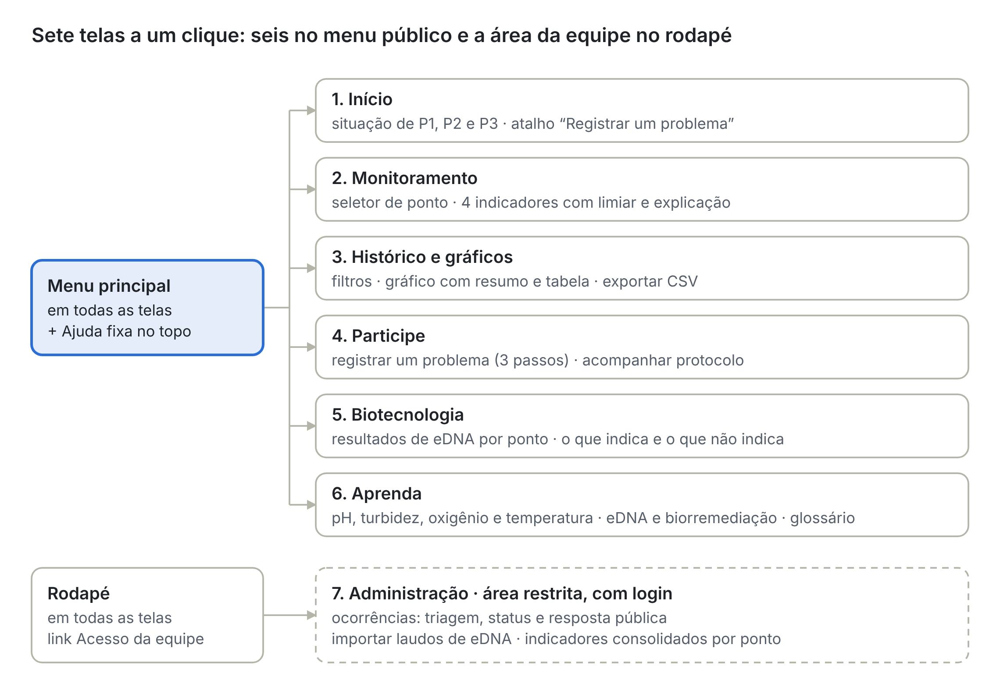
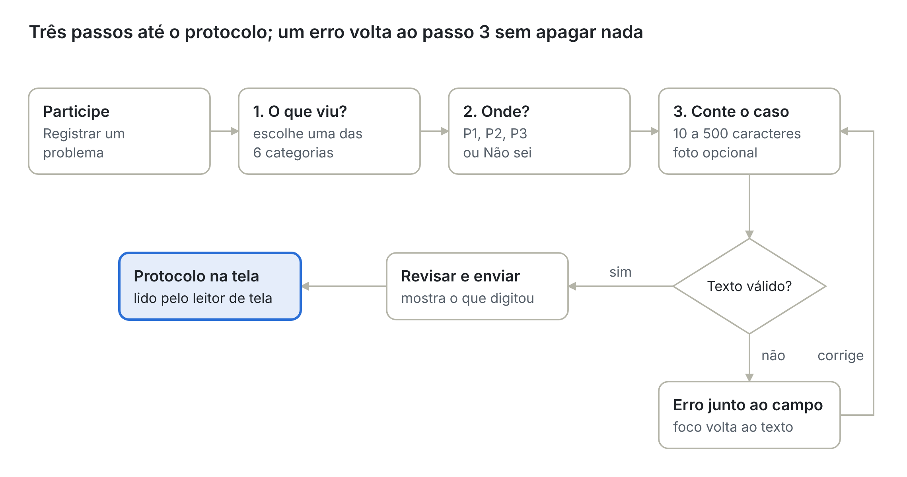

# Personas, Requisitos e Arquitetura da Informação
## FALTA PASSAR PRO LATEX ##

A EcoCidade Bio atende três perfis com perguntas diferentes: a cidadã que quer saber se o córrego está piorando, o agente que quer saber onde agir primeiro e a pesquisadora que quer publicar e cruzar dados com rigor. Este documento descreve uma pessoa por perfil, os requisitos que derivam delas e a arquitetura da informação que os organiza.

**Como as personas foram construídas:** são proto-personas, ou seja, arquétipos baseados no enunciado, na literatura de IHC (COOPER et al., 2014; BARBOSA; SILVA, 2010) e em situações comuns de uso de serviços públicos digitais.

As três personas cobrem os grupos citados na questão 2 do estudo de caso: pessoa idosa com pouca experiência digital (Shirey), uso em campo com conectividade instável (Jason) e pessoa com deficiência visual que usa leitor de tela (Andy).

|                          | Shirley Silva                         | Jason Duval                                | Dra. Andy Duarte                      |
|--------------------------|----------------------------------------|--------------------------------------------|----------------------------------------------|
| **Perfil**               | Cidadã                                 | Agente ambiental                           | Pesquisadora                                 |
| **Pergunta ao sistema**  | “O córrego está pior? Como eu aviso?”  | “Onde eu ajo primeiro?”                    | “Como publico e cruzo os dados com rigor?”   |
| **Dispositivo principal**| Celular Android de entrada             | Tablet em campo; notebook no escritório    | Notebook com leitor de tela e ampliador      |
| **Experiência digital**  | Baixa                                  | Alta                                       | Alta                                         |
| **Telas mais usadas**    | Início, Participe, Aprenda             | Monitoramento, Histórico, Administração    | Biotecnologia, Histórico, Administração      |

## Persona 1 - Shirley Silva - Cidadã ##
"Eu vejo o córrego todo dia. Só queria saber se alguém está olhando e se adianta reclamar."

| Atributo              | Descrição                                                                                  |
|-----------------------|--------------------------------------------------------------------------------------------|
| Idade e ocupação      | 67 anos, costureira aposentada                                                             |
| Onde vive             | Há 30 anos na mesma rua, a duas quadras do P2 (trecho urbano)                              |
| Tecnologia            | Celular Android de entrada, presente do neto; usa WhatsApp, chamadas de vídeo e câmera     |
| Escolaridade          | Ensino fundamental completo                                                                |
| Visão                 | Usa óculos para perto; tem dificuldade com letras pequenas e cinza-claro                   |
| Relação com o tema    | Lembra do córrego limpo; hoje vê lixo nas margens e sente cheiro forte em alguns dias      |

**Objetivos:**
* Saber, em linguagem simples, se a situação do córrego perto de casa está melhor ou
pior.
* Avisar a prefeitura sobre lixo e cano de esgoto sem precisar ir pessoalmente.
* Saber se o aviso dela foi atendido.

**Dificuldades:**
* Não entende termos como “turbidez”, “NTU” ou “oxigênio dissolvido”.
* Desiste quando o site pede cadastro, CPF ou senha
* Tem medo de apertar o botão errado e “estragar alguma coisa”.
* Botões pequenos e próximos fazem ela tocar no lugar errado.

**Necessidades e implicações do projeto:**

| Necessidade                         | Como a plataforma responde                                                  | Requisito         |
|-------------------------------------|-----------------------------------------------------------------------------|-------------------|
| Entender a situação sem jargão      | Selo com texto e ícone (“Prioridade de investigação”) e frase explicativa   | RF02, RU03, RU06  |
| Registrar sem cadastro              | Formulário anônimo em 3 passos                                              | RF05, RU09        |
| Saber o que aconteceu com o aviso   | Número de protocolo e consulta pelo número                                  | RF06              |
| Ler e tocar com conforto            | Texto ampliável, alto contraste, botões de 44 × 44 px                       | RU02, RU07, RU08  | 

**Cenário:** Num sábado de manhã, Shirley vê um sofá e sacos de lixo na margem. Ela abre o
link que recebeu no grupo do bairro, toca em "Registrar um problema", escolhe "Descarte
irregular de resíduos", marca "P2 — Urbano" e tira uma foto. A tela mostra o protocolo OC2026-0009 em letras grandes. Na semana seguinte ela digita o número e lê: "Concluída: resíduos recolhidos em 20/10".

**Tarefas principais:** ver a situação do ponto perto de casa; registrar uma ocorrência; acompanhar o protocolo; ler o que significa cada indicador.

## Persona 2 - Jason Duval - Agente Ambiental ##
"Tenho três planilhas, um e-mail do laboratório e um caderno com reclamações. Preciso de uma tela que me diga por onde começar."

| Atributo        | Descrição                                                                                                  |
|-----------------|------------------------------------------------------------------------------------------------------------|
| Idade e cargo   | 34 anos, técnico ambiental da Secretaria Municipal de Meio Ambiente de Santa Aurora                        |
| Formação        | Tecnólogo em Gestão Ambiental                                                                              |
| Rotina          | Manhãs em vistorias de campo; tardes no escritório respondendo demandas e produzindo relatórios            |
| Tecnologia      | Tablet da prefeitura em campo (sinal 4G instável nas margens); notebook no escritório; usa planilhas com frequência |
| Equipe          | Divide o atendimento com mais um colega; recebe cerca de 10 demandas por semana                            |

**Objetivos:**
* Saber, logo ao abrir o sistema, qual ponto exige ação primeiro e por quê.
* Ver a tendência dos indicadores para justificar vistorias e pedidos de análise.
* Triar as ocorrências dos cidadãos, encaminhar e dar retorno público.
* Exportar dados para relatórios internos.

**Dificuldades:**
* Os dados estão em arquivos diferentes, sem relação entre medições, laudos e reclamações.
* Em campo, o sol forte reduz a leitura da tela e o sinal de internet cai.
* Um sensor sem comunicação pode parecer um ponto "sem problema".
* Alertas que mudam a toda hora fazem a equipe deixar de confiar no sistema.

**Necessidades e implicações do projeto:**

| Necessidade                         | Como a plataforma responde                                                     | Requisito         |
|-------------------------------------|--------------------------------------------------------------------------------|-------------------|
| Prioridade clara                    | Painel com a classificação de cada ponto e os indicadores que a causaram       | RF02, RF04        |
| Histórico e tendência               | Filtros por ponto, parâmetro e período, com gráfico e tabela                   | RF03              |
| Distinguir falha de normalidade     | Aviso “sensor sem comunicação desde…” e classificação “Inconclusivo”           | RF04, RF12        |
| Triagem ágil                        | Lista de ocorrências com filtro por status e campo de resposta pública         | RF09              |
| Uso em campo                        | Alto contraste, páginas leves e layout de coluna única                         | RU02, RU08, RU11  |
| Relatórios                          | Exportação CSV dos dados filtrados                                             | RF10              |

**Cenário:** Na segunda-feira, Jason abre o painel e vê o P3 em "Prioridade de investigação"
com os três indicadores fora do limite, e o P2 passando de "Atenção" para "Prioridade". No
histórico, confirma que a turbidez do P3 sobe há três semanas. Na área da equipe,
encontra duas ocorrências no P3 (espuma e peixes mortos) e uma no P2 (cano de esgoto).
Ele agenda vistoria no P3, encaminha o caso do P2 à vigilância sanitária e atualiza o status
das três ocorrências.

**Tarefas principais:** identificar o ponto prioritário; analisar a tendência; verificar falhas de
sensor; triar e responder ocorrências; exportar dados.

## Persona 3 - Dra. Andy Duarte - Pesquisadora ##
"Um resultado de DNA ambiental mal explicado vira manchete errada. E um gráfico sem tabela simplesmente não existe para mim."

| Atributo                | Descrição                                                                                          |
|-------------------------|----------------------------------------------------------------------------------------------------|
| Idade e cargo           | 45 anos, bióloga e bioinformata do laboratório parceiro da prefeitura (universidade pública)       |
| Formação                | Doutorado em Ecologia, com experiência em metabarcoding de eDNA                                    |
| Deficiência             | Baixa visão por retinopatia; usa leitor de tela (NVDA), ampliação de 200% a 300% e alto contraste  |
| Tecnologia              | Notebook; navega principalmente por teclado; usa planilhas e scripts de análise                    |
| Relação com o sistema   | Envia os laudos de eDNA e usa os dados físico-químicos para interpretar os resultados              |

**Objetivos:**
* Publicar os resultados de eDNA com os metadados necessários (data, método, lote, marcador).
* Ver a tendência dos indicadores para justificar vistorias e pedidos de análise.
* Triar as ocorrências dos cidadãos, encaminhar e dar retorno público.
* Exportar dados para relatórios internos.

**Dificuldades:**
* Gráficos sem alternativa textual são inacessíveis pelo leitor de tela.
* Campos de formulário sem rótulo são anunciados apenas como "editar texto".
* Layouts que quebram com zoom alto escondem botões e menus.
* Sistemas que transformam "Detectado" em "Contaminado" distorcem a ciência.
* Planilhas recebidas sem padrão geram erros de importação.

**Necessidades e implicações de projeto.**

| Necessidade                  | Como a plataforma responde                                                  | Requisito |
|------------------------------|-----------------------------------------------------------------------------|-----------|
| Acesso aos dados de gráficos | Resumo textual e tabela de dados em todo gráfico                            | RU04      |
| Operar sem mouse             | Navegação completa por teclado, foco visível, componentes nativos           | RU01      |
| Zoom sem perda               | Layout responsivo a 320 px e 200% de zoom                                   | RU08      |
| Importação confiável         | Modelo CSV com vocabulário controlado e mensagens de erro por linha         | RF08      |
| Interpretação responsável    | Textos fixos “o que indica / o que não indica” em cada resultado            | RF07      |
| Dados abertos                | Exportação CSV com aviso de uso didático                                    | RF10      |

**Cenário:** Andy recebe os resultados do lote 01. Ela entra na área da equipe só com o
teclado, colando a senha pelo gerenciador de senhas, e importa o CSV. O sistema recusa
uma linha com "Positivo" e explica que os valores aceitos são "Detectado", "Não
detectado" e "Indeterminado". Depois de corrigir, ela abre a tela Biotecnologia, ouve a
tabela pelo leitor de tela e confirma que o resultado indeterminado do P2 aparece com a
recomendação de nova amostra.

**Tarefas principais:** importar resultados de laboratório; consultar a leitura integrada por
ponto; revisar os textos de interpretação; exportar dados.

## Requisitos Funcionais ##

São 12 requisitos funcionais; 7 são essenciais para o protótipo cobrir as seis telas mínimas
e as quatro tarefas de teste. Origem: C = Shirley (cidadã), A = Jason (agente), P = Andy
(pesquisadora).

| Código | Requisito                                                                                         | Origem | Prioridade | Critério de aceitação                                                                                                  |
|--------|---------------------------------------------------------------------------------------------------|--------|:----------:|------------------------------------------------------------------------------------------------------------------------|
| RF01   | Consultar os pontos de monitoramento em lista e mapa, com a situação atual de cada um            | C, A   | Essencial  | A tela Início mostra P1, P2 e P3 com selo de situação e data da última coleta                                          |
| RF02   | Exibir a última medição de cada ponto (temperatura, pH, turbidez, OD), com data e classificação  | C, A   | Essencial  | Para o P3, mostra 62 NTU, pH 5,8, OD 3,4 mg/L, 16/10/2026 e “Prioridade de investigação”                               |
| RF03   | Filtrar o histórico por ponto, parâmetro e período, com gráfico e tabela equivalente             | A, P   | Essencial  | Filtro “P3, turbidez, 02 a 16/10” exibe 3 valores (35, 48, 62) no gráfico e na tabela                                  |
| RF04   | Calcular e exibir alertas operacionais pelas regras didáticas, tratando dados ausentes           | A      | Essencial  | As 9 medições do enunciado recebem a classificação esperada; dado ausente nunca vira “Sem alerta”                     |
| RF05   | Registrar ocorrência sem cadastro (categoria, ponto aproximado, descrição, foto opcional) e gerar protocolo | C | Essencial | Envio válido gera protocolo no formato OC-AAAA-NNNN; descrição com menos de 10 caracteres é recusada com mensagem clara |
| RF06   | Acompanhar a ocorrência pelo número de protocolo                                                  | C      | Importante | Protocolo existente mostra status e resposta pública; inexistente mostra “Protocolo não encontrado. Confira os números.” |
| RF07   | Exibir resultados de eDNA por ponto com “o que indica” e “o que não indica”                       | C, P   | Essencial  | Cada um dos 6 resultados aparece com os dois textos e com a data da coleta ou “não informada”                          |
| RF08   | Importar resultados laboratoriais (CSV) com validação de vocabulário e metadados                  | P      | Importante | Linha com valor fora de Detectado, Não detectado ou Indeterminado é recusada com o número da linha                     |
| RF09   | Painel administrativo para triagem de ocorrências e indicadores consolidados                      | A      | Essencial  | Agente filtra por status, altera status e publica resposta; painel mostra contagem de alertas por ponto                |
| RF10   | Exportar dados filtrados em CSV, com aviso de uso didático                                        | A, P   | Desejável  | O arquivo exportado abre em planilha com acentos corretos e traz o aviso na primeira linha                             |
| RF11   | Conteúdo educativo sobre cada indicador e glossário                                               | C      | Importante | Cada indicador tem explicação de até 3 frases acessível a partir do cartão do indicador                                |
| RF12   | Receber leituras de sensores IoT, rejeitar valores impossíveis e sinalizar falhas                 | A      | Importante | pH 15,2 é descartado e registrado; leitura ausente aparece como “sensor sem comunicação”                              |

## Requisitos de Usabilidade e Acessibilidade ##

Os 11 requisitos usam a WCAG 2.2 nível AA como referência e acrescentam metas de linguagem simples, eficiência e leveza que a norma não exige, mas que as personas pedem.

| Código | Requisito                                                                  | Persona mais afetada | Referência                                         | Como verificar                                          |
|--------|----------------------------------------------------------------------------|----------------------|----------------------------------------------------|---------------------------------------------------------|
| RU01   | Todas as funções operáveis por teclado, com foco visível e nunca encoberto | Andy               | WCAG 2.1.1, 2.4.7, 2.4.11                          | Percorrer as 7 telas só com Tab, setas, Enter e Esc     |
| RU02   | Contraste mínimo de 4,5:1 para texto e 3:1 para elementos gráficos         | Shirley, Jason      | WCAG 1.4.3, 1.4.11                                 | Calcular o contraste de cada par de cores da paleta     |
| RU03   | Situação de alerta indicada por texto e ícone, nunca só por cor            | Todas                | WCAG 1.4.1                                         | Ver as telas em escala de cinza                         |
| RU04   | Todo gráfico com resumo textual e tabela de dados                          | Andy               | WCAG 1.1.1                                         | Leitor de tela lê o resumo e a tabela                   |
| RU05   | Formulários com rótulos visíveis, instruções e erros que dizem como corrigir | Shirley, Andy    | WCAG 3.3.1, 3.3.2, 3.3.3                           | Enviar o formulário vazio e com descrição curta         |
| RU06   | Linguagem simples, com termos técnicos explicados na primeira vez          | Shirley              | Boa prática (WCAG 3.1.5, nível AAA, como inspiração) | Revisão dos textos por alguém de fora da área         |
| RU07   | Alvos de toque com no mínimo 24 × 24 px; o projeto adota 44 × 44 px        | Shirley, Jason      | WCAG 2.5.8                                         | Medir os botões nas ferramentas do navegador            |
| RU08   | Layout legível em 320 px de largura e com zoom de 200%                     | Andy, Jason       | WCAG 1.4.4, 1.4.10                                 | Testar com janela estreita e zoom                       |
| RU09   | Registrar uma ocorrência em até 3 passos, com meta de até 2 minutos        | Shirley              | Meta de eficiência (ISO 9241-11)                   | Medir o tempo da tarefa T4 nos testes                   |
| RU10   | Link de ajuda sempre no mesmo lugar                                        | Shirley              | WCAG 3.2.6                                         | Conferir a posição nas 7 telas                          |
| RU11   | Páginas leves, com meta de até 1 MB, para redes móveis lentas              | Jason, Shirley      | Inclusão e sobriedade digital                      | Medir o peso da página nas ferramentas do navegador     |

## Mapa de Navegação ##

Toda tela pública fica a um clique de qualquer outra, porque o menu principal aparece em todas. A área da equipe fica fora do menu público, acessível pelo rodapé, para não confundir a Shirley com funções que ela não pode usar.

**Sete telas a um clique: seis no menu público e a área da equipe no rodapé**

A ordem do menu segue a frequência de uso esperada: primeiro o que todos consultam
(Início, Monitoramento), depois o aprofundamento (Histórico), a ação do cidadão
(Participe) e o conteúdo especializado e educativo (Biotecnologia, Aprenda). O logotipo
sempre leva ao Início, e o link “Ajuda” fica sempre no canto superior direito (WCAG 3.2.6).

## Fluxo de Tarefas ##

A tarefa mais longa, registrar um problema, termina em protocolo depois de 3 passos e
uma revisão. Um erro de preenchimento leva o foco de volta ao campo com problema, sem
apagar o que já foi digitado (WCAG 3.3.1, 3.3.3 e 3.3.7).

**Três passos até o protocolo; um erro volta ao passo 3 sem apagar nada**

As outras três tarefas de testes são curtas e lineares:
1.  **T1 — Localizar o P3:** Início → cartão "P3 — Industrial" (1 passo).
2.  **T2 — Consultar a última turbidez do P3:** Monitoramento → P3 → cartão Turbidez: "62
NTU · acima do limite de 25 · coleta de 16/10/2026" (2 passos).
3. **T3 — Interpretar o eDNA do P3:** Biotecnologia → P3 → "Cianobactéria: detectada",
com "Isso indica que havia DNA de cianobactérias na água. Não indica, sozinho,
floração nem toxinas" (2 passos).

**Fluxo do agente (Jason):** Acesso da equipe → login → painel com contagem de alertas por
ponto → lista de ocorrências filtrada por “Recebida” → abrir ocorrência → mudar status e
escrever resposta pública → salvar. A resposta aparece para o cidadão na consulta pelo
protocolo.

**Fluxo da pesquisadora (Andy):** Acesso da equipe → login → Importar laudos → escolher
arquivo CSV → o sistema valida linha por linha → linhas com erro aparecem em lista com
número e motivo → corrigir e reenviar → resultados publicados na tela Biotecnologia.

## Rotulagem ##

Os rótulos da interface usam as palavras da Shirley; o termo técnico aparece ao lado,
entre parênteses ou na tela Aprenda, para o Jason e a Andy. A regra é: primeiro a palavra
do cidadão, depois o termo técnico, nunca o contrário.

| Termo técnico                       | Rótulo na interface                                    | Explicação curta (tela Aprenda)                                                  |
|-------------------------------------|--------------------------------------------------------|----------------------------------------------------------------------------------|
| Ocorrência ambiental                | Registrar um problema                                  | Avise a prefeitura sobre lixo, esgoto, cheiro ou peixes mortos                   |
| Área de ocorrências / participação  | Participe                                              | Registre um problema ou acompanhe um aviso já feito                              |
| Protocolo                           | Número para acompanhar                                 | Guarde este número para saber o que foi feito                                    |
| Ponto de monitoramento              | Ponto (com o nome do trecho: “P2 — Urbano”)            | Lugar do córrego onde a água é medida                                            |
| Classificação operacional           | Situação                                               | Sem alerta, Atenção ou Prioridade de investigação                                |
| Prioridade de investigação          | Prioridade de investigação                             | A prefeitura deve verificar este ponto primeiro. Não é um laudo                  |
| Turbidez (NTU)                      | Turbidez (água turva)                                  | O quanto a água está turva. Acima de 25, entra em alerta                         |
| Oxigênio dissolvido (mg/L)          | Oxigênio na água                                       | O ar que os peixes respiram. Abaixo de 5, entra em alerta                        |
| pH                                  | pH (acidez da água)                                    | Perto de 7 é neutro. Abaixo de 6 ou acima de 9, entra em alerta                  |
| DNA ambiental (eDNA)                | DNA ambiental                                          | Pedacinhos de DNA que os seres vivos deixam na água                              |
| Indeterminado                       | Resultado incerto (será repetido)                      | O laboratório não conseguiu confirmar; uma nova amostra será feita               |
| Dado ausente / falha de comunicação | Sem leitura: sensor sem comunicação desde [data e hora] | O aparelho não enviou dados. Isso não quer dizer que a água está boa            |
| Administração                       | Acesso da equipe                                       | Área restrita a servidores da prefeitura e ao laboratório                        |
| Base de conhecimento                | Aprenda                                                | Explicações sobre os indicadores e a biotecnologia                               |
